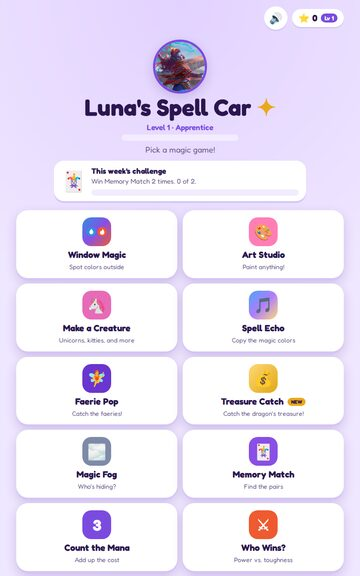
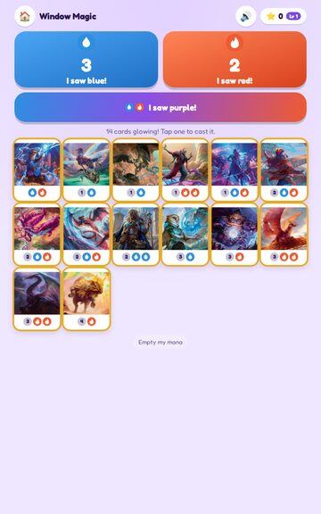
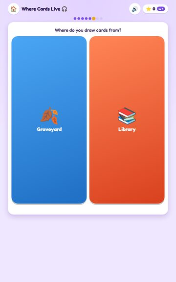
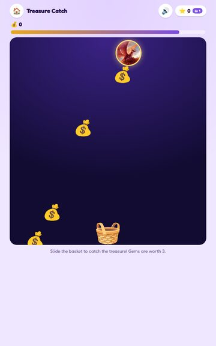
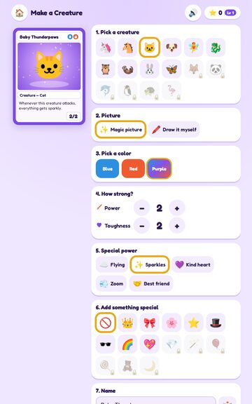

# Luna's Spell Car ✨

A free, car-friendly app that teaches a young child to play Magic: The Gathering, built around one
**Prismari Artistry** (blue-red) Commander deck. Every prompt is read aloud, buttons are big, most games work
without reading, and there's an eyes-closed mode for car rides.

<p>





</p>

## Install (Android)

1. Download `luna-spell-car.apk` from the [latest release](../../releases/latest).
2. Open it on the tablet and allow "Install unknown apps" for the app that opened it
   (Fire tablets: Settings → Security & Privacy → Apps from Unknown Sources).
3. Updates install over the old version and keep all saved progress (see the signing note under **Build**).

**No server, works offline.** The released APK has no server address or token built in. Everything runs on the
tablet. Grown-ups can optionally connect their own **Spell Car server** (stories, AI pictures, neural voices; see
`server/README.md`) under **For grown-ups**. No ads, accounts, analytics, or data collection; saved progress stays
on the device unless you make a backup file yourself. (The web build loads its font from Google Fonts; the APK
  bundles it.)

There's also a web build (`make build` → `dist/web/index.html`), where Story Time can use Claude.

## Games

| Game | What it teaches |
|---|---|
| **Window Magic** | Spot blue/red/purple things outside to build a mana pool, then cast cards she can afford. Real cost rules: colored symbols need that color, gray numbers take any color. |
| **Magic movies** | With a Spell Car server + Google Veo: cards and creatures come to life in 10-second clips when cast or tapped; made once, stored for offline play. |
| **Art Studio** | Free painting with crayon, rainbow, sparkle and heart brushes; saved gallery. |
| **Make a Creature** | Design a creature card (kind, picture, color, power/toughness, special power, accessory, name). **Draw it myself** opens a paint canvas (crayon, rainbow, sparkle and heart brushes, trace-along guide). Stronger creatures cost more. Saved creatures show up in every other game. |
| **Mana Bubbles** | Pop floating blue/red bubbles to fill a card's cost slots; colored slots need that color, gray slots take any. |
| **Story Time** | A gentle story starring her creatures, read aloud with sentence highlighting. Web: Claude (claude.ai `sample` capability). Tablet: Azure OpenAI via the Spell Car server. |
| **Memory Match** | Flip-and-find pairs with deck art and her creatures. |
| **Spell Echo** | Simon-style color-and-sound memory; longer and faster each round. |
| **Faerie Pop** | 30-second tap-the-faeries; unicorns worth 3; leave the sleeping owl alone. |
| **Magic Fog** | A card hides in fog that slowly clears; pick the matching picture (faster = more stars). |
| **Magic School** | Twelve spoken lessons from the Spellbook PDF, from colors to Rootha's Elemental trick, plus a guided practice turn and a printable diploma. |
| **Star Map** | Twelve harder hidden treasures that light up a dragon constellation; all twelve unlock the Starlight theme. |
| **Star Shop & levels** | Spend stars on creatures, accessories, themes, and brushes; ten levels from lifetime stars; nine hidden secrets that open a Secret Garden theme. |
| **Count the Mana** | Tap each mana symbol to count it, then pick the total. |
| **Who Wins?** | Power vs. toughness, with dots to compare. |
| **Rootha Says** | Simon Says read aloud; eyes-free. |
| **Game Night** | Life counter for real games: 2–4 players, 20 or 40 life, ±1/±5, "face each other" flip for tablets on the table, d6/d20, coin, who goes first. |
| **My Spellbook** | Stickers every 10 stars, her creatures (tap to edit), cards she's cast, **Print my creatures** (real-card-size PDF, 63 × 88 mm, 9 per US Letter page), and **Backup / Restore** (JSON file; restore merges and never deletes). |

## Layout

```
web/app.html          the whole app (HTML/CSS/JS); __CARDS__ is filled from cards.json
web/cards.json        deck cards with embedded art (base64 JPEG)
web/tts-shim.js       maps the Web Speech API onto Android's native TextToSpeech
web/build.py          builds dist/web/index.html and android/assets/
server/               optional Spell Car server: Azure OpenAI stories + pictures, Azure Speech voices (see server/README.md)
web/fonts, web/vendor bundled Fredoka font and jsPDF 2.5.1 for offline use
android/              manifest, MainActivity (WebView + TTS + file bridge), PdfProvider, icons
build_apk.sh          Gradle-free build: aapt2 → javac → d8 → zipalign → apksigner
```

## Develop

See **DEVELOPMENT.md** for the full cycle (`make dev`, `make test`, `make release`, `make install`) and **ROADMAP.md** for what's next.

## Build

Requirements: JDK 17+, Python 3, Android SDK with `platforms;android-34` and `build-tools;34.0.0`.

```bash
export ANDROID_HOME=/path/to/android-sdk
make apk          # → build/luna-spell-car.apk at the version in VERSION
make build        # web only → dist/web/index.html
```

The APK is signed with `android/luna-debug.keystore` (password `android`, alias `luna`), a **public debug key**
committed on purpose so any machine (and CI) can build an update that installs over the old one. That also means
anyone could sign an APK that installs over it, so only install APKs from this repo's Releases page.
`versionCode` is derived from `VERSION`, so each release installs over the last.

## Text-to-speech

With a Spell Car server connected, stories (or everything) can use Azure neural voices instead, including
Ana, a child's voice; the app falls back to the tablet's voice whenever the server can't be reached.


Android's WebView has no `speechSynthesis`, so `tts-shim.js` replaces it with a bridge to the
system `TextToSpeech` engine (`AndroidBridge.speak/stop/voices`), including end-of-speech
callbacks so Rootha Says and Story Time pace correctly. In the app's **For grown-ups** panel:
reading speed, voice picker, and a shortcut to the tablet's voice settings. For better voices,
install/update **Speech Services by Google** and download a high-quality English voice there.

## Notes

- Saved data (stars, creatures, stories) lives in each device's local storage. Use **My Spellbook → Backup**
  to move it between the tablet and the web version.

See CHANGELOG.md for release notes.

## Fan content, credits, and licenses

Luna's Spell Car is unofficial Fan Content permitted under the Fan Content Policy. Not approved/endorsed by Wizards. Portions of the materials used are property of Wizards of the Coast. ©Wizards of the Coast LLC.

- Card art in `web/cards.json` is © Wizards of the Coast; artists are credited in the app (For grown-ups). Images via
  [Scryfall](https://scryfall.com). The app is free and always will be: no ads, no purchases, no donations.
- No Wizards logos or trademarks are used. The mana symbols are simple drawings made for this app (a water drop and a
  flame); the app icon uses Rootha's card art.
- Font: [Fredoka](https://github.com/hafontia/Fredoka-One), SIL Open Font License 1.1 (`web/fonts/OFL.txt`).
- PDF export: [jsPDF](https://github.com/parallax/jsPDF) 2.5.1, MIT license (`web/vendor/`).
